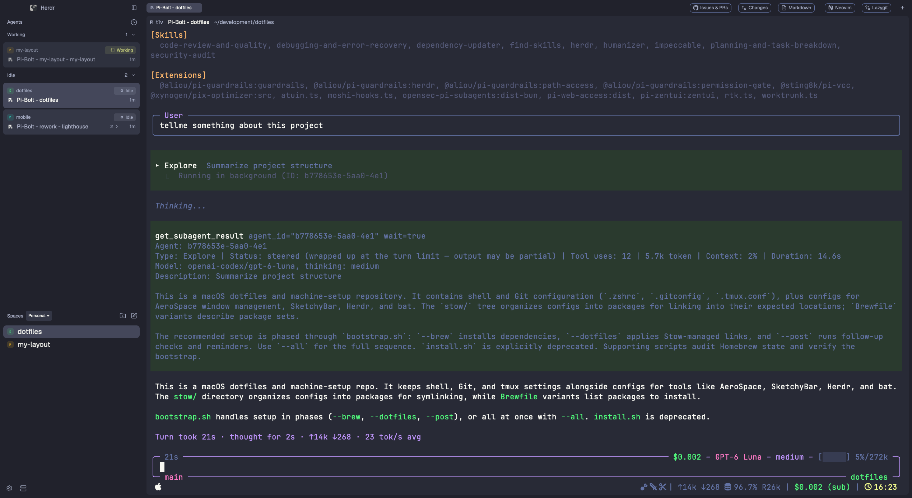

# Herdr Workbench

A Dracula Classic terminal-first Herdr layout with profile-aware spaces, agent activity, Markdown browsing, modal Neovim/Lazygit launchers, a Changes panel, and an optional GitHub issues/PR panel.



See [`RECIPE.md`](RECIPE.md) for the full layout specification, required mods, behavior, limitations, and verification steps. The package is under `layouts/`, `mods/`, and `themes/`; install `themes/dracula.json` as `~/.config/herdr-app/themes/dracula.json` so the layout can load its palette.

## Requirements

- Herdr App.
- `git`, `sh`, `find`, `date`, `touch`, and `mktemp` on the machine running the spaces; Markdown uses Git changes inside repositories and files modified today otherwise.
- **Optional GitHub panel:** the [`gh` CLI](https://cli.github.com/) installed and authenticated (`gh auth login`), plus an active space whose Git remote points to GitHub. The rest of the layout works without it.
- **Optional editor tools:** `nvim` and `lazygit` installed on the active space's machine.
- **macOS notifications:** Agent-status and PR-check success alerts use `osascript`. Clicking an agent alert opens Script Editor; this AppleScript notification route has no custom click action. The “Open on GitHub” button invokes macOS’s `open` command; adapt it on other operating systems.

## Theme

The layout pins Dracula Classic: background `#282A36`, foreground `#F8F8F2`, selection `#44475A`, and purple accent `#BD93F9`. Its 16 ANSI colors and Herdr UI role mappings are in [`themes/dracula.json`](themes/dracula.json), based on the [official Dracula specification](https://draculatheme.com/spec).

## Included mods

The layout directly uses `t3-chrome` (brand/footer), `t3-agents`, `my-spaces`, `t3-tabs`, `t3-pane`, `t3-menu`, `t3-new-menu`, `my-markdown`, and `my-tools`. `t3-home` and `t3-picker` are opened through the tab bar's Home/Go to flows. Tab-close confirmation is owned by `t3-tabs`. The Markdown button lists new or modified `.md` files in the active Git project, or files modified today when the project is outside Git, and opens them in an in-layout `TextView.markdown` viewer. Neovim and Lazygit launch in modal terminals using the focused space's folder and machine. The Changes panel uses `my-changes-toggle` and Herdr's built-in `changes` mod. The optional GitHub panel uses both `my-github-toggle` and `my-github`.

## Suggested shortcuts

Add these layout-scoped bindings to `~/.config/herdr-app/keys.json` (the prefix is `Alt+A`):

```json
{
  "layout:herdr-workbench": {
    "cmd-p": "mod.open:picker",
    "cmd-shift-p": "app.palette",
    "alt-a e": "my-tools.nvim",
    "alt-a y": "my-tools.lazygit",
    "alt-a m": "my-markdown.open",
    "alt-a c": "my-changes-toggle.toggle",
    "alt-a g": "my-github-toggle.toggle",
    "alt-a shift-c": "tab.new"
  }
}
```

Merge this section into your existing `keys.json`. The last binding preserves the default new-tab action after assigning `Alt+A C` to Changes.

The former shared chrome icons are replaced with layout-authored SVGs stored in the mods that use them; `workspace-chrome` is no longer bundled just for shared assets.

Licensed under Apache-2.0; see [`LICENSE`](LICENSE) and [`THIRD-PARTY-NOTICES.md`](THIRD-PARTY-NOTICES.md).
