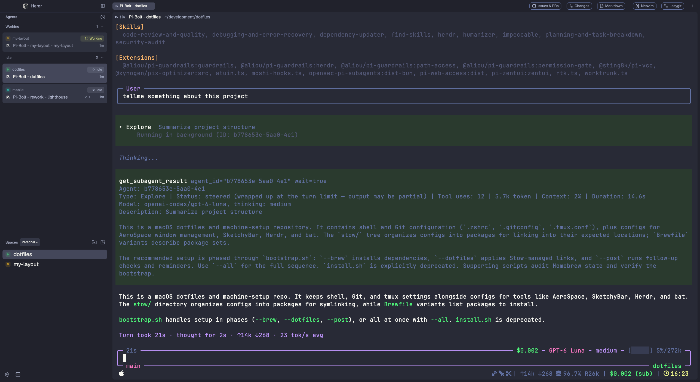

# Herdr Workbench
A dark, terminal-first workspace with agent activity and project spaces on the left, tabs and panel controls above the terminal, and an optional GitHub issues/PR panel. It uses Dracula Classic colors and inherits the user's font settings; the theme picker can still override the layout's theme. 

## What you see
- **Left sidebar (256px; min 208, max 480; not resizable):** 40px brand header; flexible agent and spaces lists (each min 90px); 44px footer. Agent entries group into Needs you, Done, Working, and Idle. Spaces use equal profile-aware lists. The sidebar uses the theme's `chrome` color.
- **Top bar (40px):** flexible tabs, a 124px GitHub toggle, a 100px Changes toggle, and a 36px tab-bar end control.
- **Work area:** active tab with 8px horizontal inset and gap. Panes have always-visible 28px top headers, 8px radius/gap and 2px theme-background borders; focused panes use the same border color. Terminals have `[8,0]` padding and zero opacity.
- **Side panel:** hidden by default; when shown, 400px wide (min 300, max 650), with Changes and GitHub views in a mutually exclusive stack. An 8px bottom inset finishes the work column. Root title bar is hidden; macOS traffic lights are at `[16,12]`.

## How it behaves
- Agent states rank **Needs you** (blocked), **Done**, **Working**, **Idle**. Working uses a spinner; blocked uses an exclamation mark; idle a ring; done a dot. Sub-agents contribute to their parent's urgency. Rows can be focused, folded, pinned, and opened; hover reveals controls and labels. A macOS notification appears when an agent newly needs attention.
- Spaces are grouped by repository/worktree and machine. The profile picker lets people create, rename, delete, and switch profiles, and move spaces between them. New spaces belong to the active profile; rows can be selected, reordered, or opened in another machine. Git status and project icons update from the current folders.
- Tabs can be selected, renamed, reordered, and closed. Pane headers split, zoom, focus, or close panes. New-space/tab controls open their respective menus; closing a running terminal asks for confirmation in `t3-tabs`. The terminal right-click menu is `t3-menu`.
- **Issues & PRs** toggles the GitHub panel. It finds the active project's GitHub remote, fetches open issues/PRs, shows PR checks separately from mergeability, and opens selected items in a browser. Successful PR checks trigger a macOS notification; polling is every five minutes.

## Built from
Use `layouts/herdr-workbench.json` with `theme: "dracula"`; install `themes/dracula.json` as `~/.config/herdr-app/themes/dracula.json`. Its root is a row: a 256px `sidebar` column (`t3-chrome`, `t3-agents`, `my-spaces` with `newMenu: t3-new-menu`, and `t3-chrome` footer) beside `work`. `work` contains the top bar (`t3-tabs`, `my-github-toggle`, `my-changes-toggle`, and `t3-tabs` with `part: end`), then the active tab and a hidden 400px panel. The panel is a stack of Herdr's `changes` mod and `my-github`; the toggle buttons select a view and show or hide the shared panel. An 8px inset finishes the work column. The active-tab block uses `t3-pane` for pane headers. `t3-menu` is the layout's terminal menu; `t3-tabs` also renders tab-close confirmation.

Bundle every directory under `mods/`: `my-spaces`, `my-github`, `my-github-toggle`, `my-changes-toggle`, `t3-agents`, `t3-chrome`, `t3-home`, `t3-menu`, `t3-new-menu`, `t3-pane`, `t3-picker`, and `t3-tabs`. The T3 mods provide the branded sidebar, agent list, tab bar, pane controls, Home/Go to views, and new/context menus; the `my-*` mods add profiles and the two panel toggles/GitHub view. They use Herdr's `spaces`, `panes`, `agents`, `machines`, `shared`/`setShared`, `theme`, `props`, `hc`, `exec`, `openOverlay`, and `run` APIs, including `space.*`, `tab.*`, `pane.*`, `layout.toggle`, `layout.select`, `layout.show`, `layout.hide`, and `agent.focus` commands.

## Watch out
`my-github` optionally requires the `gh` CLI authenticated with `gh auth login` and a GitHub remote in the active project's repository; without it, the rest of the layout works. It calls GitHub's REST API. Agent-needs-attention and successful PR-check notifications use `osascript`, so they work only on macOS. PR checks are polled every five minutes while the GitHub panel is active. The “Open on GitHub” action invokes macOS's `open` command and may need adapting on other systems. `my-spaces`, `t3-agents`, and `t3-new-menu` run local `git`/`sh` commands, inspect project folders for Git status and icons, and cache icons under Herdr's app home; remote spaces run commands on their machine. The layout inherits theme/fonts from settings rather than fixing them.

## Done when
- `herdr-app check <each mods/<name> folder>` passes for every bundled mod.
- The focused checks pass: `node mods/my-spaces/profile-state.test.mjs`, `node mods/t3-agents/notifications.test.mjs`, `node mods/t3-chrome/sidebar-mode.test.mjs`, and `node mods/my-github/checks.test.mjs`.
- Install `themes/dracula.json`, the layout, and mods, then `layout.switch {name: "herdr-workbench"}`; the Dracula palette, sidebar, tabs, panel toggles, and pane header render.
- Toggle Changes in a Git repository and verify the changed-file list/diff appear; toggle GitHub in a space with an authenticated GitHub remote and verify both lists load, PR details show Checks and Mergeability separately, and each button selects its panel view.
- Create two profiles and verify a new space appears only in the active profile; move it to confirm the destination changes.
